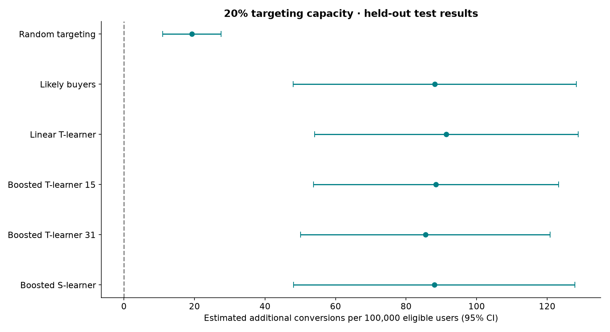

## Public results — no sign-in required

[Open the public interactive dashboard](https://mahima68.github.io/marketing-budget-uplift/) · [Read the decision memo](BUSINESS_REPORT.md)

At fixed 20% targeting capacity, the validation-selected Boosted S-learner estimates **88.0 additional purchases per 100,000 eligible users** versus targeting nobody (nominal 95% interval: 48.1–127.9).

| Paired comparison | Difference per 100,000 eligible users | Nominal 95% interval |
|---|---:|---:|
| Selected uplift policy minus random targeting | +68.7 | +36.7 to +100.7 |
| Selected uplift policy minus likely-buyer targeting | −0.15 | −5.76 to +5.47 |

The policy improved on random targeting in this benchmark, but did not establish an improvement over likely-buyer targeting. A fresh policy-level experiment is recommended before rollout. Costs and margins are hypothetical; no actual ROI improvement is claimed.



The public demo explores existing held-out results and uses no login or paid API. The original private demo below remains an alternative.

---

# Marketing Budget Optimization Using Uplift Modelling

**A notebook-based business data science project.**

A marketing team can advertise to 20% of eligible customers. Who should it choose to create additional purchases? Predicting likely buyers does not answer this: some would buy anyway. This project compares customer targeting policies using a real advertising experiment.

## Live demo

[Open the private dashboard](https://marketing-uplift-lab-171026.racinggrass8.chatgpt.site/) (ChatGPT sign-in required).

## Interactive app and API

The project now also includes an interactive dashboard, a tested FastAPI service, and a Dockerfile for hosting both together. See `DEPLOYMENT.md` for launch instructions and API examples. The dashboard explores existing held-out results; it does not retrain models.

## Start here

1. Read `BUSINESS_REPORT.md` for the outcome and recommendation.
2. Open `Marketing_Budget_Optimization.ipynb` in VS Code, Jupyter, or Google Colab. Saved outputs let you read the completed analysis without rerunning it.
3. Read `LEARNING_GUIDE.md` alongside the notebook to understand the methods.
4. Explore the charts and CSV tables in `results/`.

The notebook can be studied independently; app/API use is optional. No GPU is needed. The project does require learning basic Python, classification and causal inference; it is not a beginner one-afternoon exercise.

## What's included

- Executed, explained notebook: data sourcing → audit → experiment analysis → modelling → validation selection → held-out evaluation → business economics.
- `analysis.py`: equivalent runnable analysis source.
- `BUSINESS_REPORT.md`: decision memo populated from measured results.
- `LEARNING_GUIDE.md`: concepts, interview discussion, and limitations.
- `results/`: charts, model comparison, paired uncertainty, budget curves, deciles, scenario assumptions, split indices and provenance-backed summary.
- `data/provenance.json`: documents the original run. The data sample is regenerated on first execution; large data files are not committed.
- `data/provenance.json`: source URL, corrected version, sampling method, seed and full-source checksum.
- `requirements.txt`: versions used for this run.

## Run locally

Use Python 3.12 in a virtual environment. Install dependencies:

```sh
python -m pip install -r requirements.txt
```

Open the notebook, select that Python environment and run all cells. Alternatively, from this project folder:

```sh
python analysis.py
```

Large data files are excluded from GitHub. On its first run, the notebook downloads approximately 311 MB from the publisher, verifies its SHA-256 and creates a seeded sample across all 13,979,592 source rows. Keep enough disk space for the original and extracted-in-memory chunks. Raw data are read in chunks, not loaded all at once.

## Google Colab

Upload this project folder into Google Drive (or upload the ZIP and extract it under `/content/marketing-uplift`). Open the notebook and, before its first code cell, set the working directory to the extracted folder:

```python
%cd /content/marketing-uplift
```

For a Drive folder, use its actual `/content/drive/MyDrive/...` path after mounting Drive. Colab usually includes the core libraries; install missing dependencies from `requirements.txt` if needed. Runtime and library-version differences can produce small numerical changes. Use the local pinned environment to reproduce this run most closely.

## Study design

- Independent Bernoulli sample (11%) over the entire corrected v2.1 file, seed 42.
- 60/20/20 training/validation/test split, stratified on assignment and conversion.
- Input features: anonymized f0–f11 only; exclude treatment, conversion, visit and exposure.
- Models: purchase propensity, linear T-learner, two boosted T-learners, boosted S-learner.
- Selection: validation incremental gain at a predeclared 20% targeting capacity; only uplift candidates compete for the selected-model label.
- Final evaluation: doubly robust policy-gain estimates, independent IPW sensitivity estimates, pointwise normal intervals and paired comparisons.
- Economics: explicitly hypothetical margins and constant costs per target, not observed profit.

The test set is for final reporting. Trying more models after seeing these results requires a new holdout or nested validation; do not keep using this test set for model selection.

## Honest interpretation

Criteo altered the released data through privacy subsampling. This is a benchmark of targeting methods under stated assumptions, not an estimate of original campaign ROI. Assignment is advertising eligibility, not guaranteed ad exposure. There are no actual margin/cost fields, dates, advertiser identifiers or user identifiers. Anonymous features support ranking but do not justify invented customer personas. Confidence intervals condition on the fitted models and assume independent users; they omit training and release-sampling uncertainty.

## Attribution and data license

Diemert, Eustache; Betlei, Artem; Renaudin, Christophe; and Amini, Massih-Reza (2018). *A Large Scale Benchmark for Uplift Modeling*. AdKDD and TargetAd Workshop, KDD.

- Publisher and erratum: https://ailab.criteo.com/criteo-uplift-prediction-dataset/
- Publisher's mirror: https://huggingface.co/datasets/criteo/criteo-uplift
- Data license: Creative Commons Attribution–NonCommercial–ShareAlike 4.0, https://creativecommons.org/licenses/by-nc-sa/4.0/

The bundled sample is a modified subset (seeded sampling and type conversion); retain source attribution and license conditions. No endorsement by Criteo is implied. This project is intended for noncommercial educational use.
